# Diagramas de Funciones y Flujo Operativo - SIGOA V3.0
**Sistema Integral de Gestión y Organización Académica - Talento Humano UPEL**

Este documento consolida la arquitectura funcional, las responsabilidades por módulo y el diagrama de flujo operativo de extremo a extremo del sistema.

---

## 1. Diagrama de Funciones por Módulo

```mermaid
flowchart TD
    %% NODO PRINCIPAL
    SIGOA["SIGOA - Talento Humano UPEL (V3.0)"]

    %% MÓDULOS PRINCIPALES
    SIGOA --> MOD_PUBLICO["1. Portal Docente (Autogestión Pública)"]
    SIGOA --> MOD_LAPSOS["2. Gestión de Lapsos y Períodos"]
    SIGOA --> MOD_DIRECTORIO["3. Consulta y Auditoría Docente"]
    SIGOA --> MOD_NOMINA["4. Módulo Financiero y Nómina TXT"]
    SIGOA --> MOD_JEFATURA["5. Jefaturas de Departamento"]
    SIGOA --> MOD_SEGURIDAD["6. Seguridad, Bitácora y Respaldos"]
    SIGOA --> MOD_AVANZADO["7. Red Resiliente y Servicios Avanzados"]

    %% SUB-FUNCIONES: PORTAL PÚBLICO
    MOD_PUBLICO --> P1["Validación por Cédula y Clave Inicial"]
    MOD_PUBLICO --> P2["Registro Autónomo: Personal, Académico y Bancario"]
    MOD_PUBLICO --> P3["Consulta de Estatus: 'Por Revisar' vs 'Validada'"]
    MOD_PUBLICO --> P4["Descarga e Impresión de Ficha Oficial con QR"]
    MOD_PUBLICO --> P5["Guía de Acceso y Preguntas Frecuentes (FAQ)"]
    MOD_PUBLICO --> P6["Recuperación de Contraseña por Correo"]

    %% SUB-FUNCIONES: GESTIÓN DE LAPSOS
    MOD_LAPSOS --> L1["Ciclo de Vida: Planificación -> Activo -> Cerrado"]
    MOD_LAPSOS --> L2["Configuración: Semanas Lectivas y Vigencias Desde/Hasta"]
    MOD_LAPSOS --> L3["Propagación Masiva de Fechas a la Plantilla"]
    MOD_LAPSOS --> L4["Replicación de Carga Académica entre Semestres"]
    MOD_LAPSOS --> L5["Histórico Académico Multianual por Docente"]

    %% SUB-FUNCIONES: CONSULTA Y AUDITORÍA
    MOD_DIRECTORIO --> C1["Filtros Cruzados: Período, Departamento y Sede"]
    MOD_DIRECTORIO --> C2["Buscador en Tiempo Real con Caché RAM (0 ms)"]
    MOD_DIRECTORIO --> C3["Exportación Institucional Excel (xlsx-js-style)"]
    MOD_DIRECTORIO --> C4["Envío Automatizado de Fichas al Correo Institucional"]
    MOD_DIRECTORIO --> C5["Notificaciones Directas por WhatsApp"]

    %% SUB-FUNCIONES: FINANCIERO Y TXT
    MOD_NOMINA --> N1["Generador TXT Banco de Venezuela (BDV Posicional)"]
    MOD_NOMINA --> N2["Generador TXT Multibanco (Banesco, Mercantil, Provincial)"]
    MOD_NOMINA --> N3["Auditoría Preventiva de Cuentas (20 dígitos y Prefijos)"]
    MOD_NOMINA --> N4["Carga de Archivo de Respuesta y Conciliación de Pagos"]
    MOD_NOMINA --> N5["Enmascaramiento de Seguridad según Rol de Usuario"]

    %% SUB-FUNCIONES: JEFATURAS
    MOD_JEFATURA --> J1["Asignación de Carga: Horas Semanales y Horas Lapso"]
    MOD_JEFATURA --> J2["Gestión de Secciones, Cupos e Inscritos"]
    MOD_JEFATURA --> J3["Validación y Aprobación Formal de la Carga"]
    MOD_JEFATURA --> J4["Catálogo Estandarizado de Asignaturas"]

    %% SUB-FUNCIONES: SEGURIDAD Y RESPALDOS
    MOD_SEGURIDAD --> S1["Control de Roles: ADMIN, DOCENCIA, JEFE, AUDITOR"]
    MOD_SEGURIDAD --> S2["Bitácora de Trazabilidad Transaccional (audit_logs)"]
    MOD_SEGURIDAD --> S3["Bóveda de Respaldos: Dumps SQL y JSON en Vivo"]
    MOD_SEGURIDAD --> S4["Restauración en Caliente de la Base de Datos"]

    %% SUB-FUNCIONES: SERVICIOS AVANZADOS
    MOD_AVANZADO --> A1["Malla P2P WebRTC: Trabajo Local sin Conexión"]
    MOD_AVANZADO --> A2["Sincronización Automática Offline/Online"]
    MOD_AVANZADO --> A3["Centro de Control de Enjambre Distribuido"]
    MOD_AVANZADO --> A4["Buscador Universal Rápido (Ctrl + K)"]
    MOD_AVANZADO --> A5["Tablón de Avisos y Circulares Institucionales"]
```

---

## 2. Diagrama de Flujo del Ciclo Operativo Completo

```mermaid
flowchart TD
    %% INICIO
    INICIO(["Inicio: Inicio de Semestre / Lapso"]) --> FASE1_OPEN

    %% FASE 1: APERTURA Y PLANIFICACIÓN
    subgraph FASE1 ["Fase 1: Apertura Académica (Subdirección de Docencia / Admin)"]
        FASE1_OPEN["Crear o Activar Período Académico (ej. 2026-I)"] --> FASE1_PARAMS["Definir Parámetros: Semanas (15), Fechas Desde/Hasta"]
        FASE1_PARAMS --> FASE1_PROPAGAR["Propagar Vigencia a toda la Plantilla Docente"]
        FASE1_PROPAGAR --> FASE1_OFERTA["Habilitar Oferta Académica Institucional"]
    end

    %% FASE 2: AUTOGESTIÓN DOCENTE
    subgraph FASE2 ["Fase 2: Portal Docente (Autogestión Pública)"]
        FASE1_OFERTA --> FASE2_LOGIN["Docente ingresa al Portal con Cédula y Clave"]
        FASE2_LOGIN --> FASE2_CHECK{"¿Es primer ingreso o ya registrado?"}
        
        FASE2_CHECK -- "Primer Ingreso" --> FASE2_REG["Completar Formulario: Datos Personales, Títulos y Cuenta Bancaria (20 dígitos)"]
        FASE2_CHECK -- "Ya Registrado" --> FASE2_UPDATE["Verificar/Actualizar Datos de Contacto y Banco"]
        
        FASE2_REG --> FASE2_STATUS_INIT["Estatus Inicial: 'Por Revisar'"]
        FASE2_UPDATE --> FASE2_STATUS_INIT
    end

    %% FASE 3: ASIGNACIÓN Y VALIDACIÓN POR JEFATURA
    subgraph FASE3 ["Fase 3: Jefatura de Departamento"]
        FASE2_STATUS_INIT --> FASE3_LIST["Jefe de Departamento visualiza su plantilla"]
        FASE3_LIST --> FASE3_ASIGNAR["Asignar Materias, Secciones, Cupos y Horas (Semanales y Lapso)"]
        FASE3_ASIGNAR --> FASE3_VAL{"¿Carga Completa y Sin Conflictos?"}
        
        FASE3_VAL -- "No: Requiere Ajustes" --> FASE3_CORREGIR["Ajustar Horas o Cambiar Asignatura"]
        FASE3_CORREGIR --> FASE3_ASIGNAR
        
        FASE3_VAL -- "Sí: Aprobado" --> FASE3_APROBAR["Cambiar Estatus del Docente a 'Validada'"]
    end

    %% FASE 4: EMISIÓN DE FICHAS Y NOTIFICACIÓN
    subgraph FASE4 ["Fase 4: Emisión de Fichas y Comunicación"]
        FASE3_APROBAR --> FASE4_FICHA["Generar Ficha Académica Oficial con Firma y Código QR"]
        FASE4_FICHA --> FASE4_CANAL{"Canal de Entrega"}
        
        FASE4_CANAL --> FASE4_EMAIL["Envío Automático al Correo Institucional (Nodemailer)"]
        FASE4_CANAL --> FASE4_DESCARGA["Descarga Directa en PDF / Impresión por el Docente"]
        FASE4_CANAL --> FASE4_WA["Aviso Rápido por WhatsApp"]
    end

    %% FASE 5: NÓMINA BANCARIA Y AUDITORÍA
    subgraph FASE5 ["Fase 5: Talento Humano y Finanzas"]
        FASE4_EMAIL --> FASE5_AUDIT
        FASE4_DESCARGA --> FASE5_AUDIT
        FASE4_WA --> FASE5_AUDIT
        
        FASE5_AUDIT["Auditoría Automática de Cuentas Bancarias"]
        FASE5_AUDIT --> FASE5_BANK_CHECK{"¿Todas las cuentas tienen 20 dígitos y código válido?"}
        
        FASE5_BANK_CHECK -- "No: Hay Cuentas Inválidas" --> FASE5_ALERT["Notificar al Docente por WhatsApp/Email para Corregir Cuenta"]
        FASE5_ALERT --> FASE2_UPDATE
        
        FASE5_BANK_CHECK -- "Sí: Cuentas Validadas" --> FASE5_GEN_TXT["Generar Archivos TXT de Nómina: BDV Posicional y Multibanco"]
        FASE5_GEN_TXT --> FASE5_BANCO["Envío de Archivo al Banco para Dispersión de Pagos"]
        FASE5_BANCO --> FASE5_RESPUESTA["Cargar Archivo de Respuesta Bancaria y Conciliar Pagos"]
    end

    %% FASE 6: CIERRE Y ARCHIVO HISTÓRICO
    subgraph FASE6 ["Fase 6: Cierre del Lapso"]
        FASE5_RESPUESTA --> FASE6_RESPALDO["Generar Respaldo SQL/JSON en Bóveda de Seguridad"]
        FASE6_RESPALDO --> FASE6_HIST["Archivar Cargas en 'cargas_historicas'"]
        FASE6_HIST --> FASE6_CLOSE["Cambiar Período Académico a 'CERRADO'"]
    end

    FASE6_CLOSE --> FIN(["Fin: Lapso Culminado y Listo para Siguiente Período"])
```

---

## 3. Matriz de Roles y Responsabilidades

| Rol Institucional | Módulos Clave | Responsabilidad Primaria |
| :--- | :--- | :--- |
| **Docente (Público)** | Portal Docente | Registro personal y bancario, consulta de estatus y descarga de Ficha Oficial con QR. |
| **Jefe de Departamento** | Departamentos, Avisos, Consultar | Carga de materias, horas, secciones, cupos y aprobación formal de la carga. |
| **Subdirección de Docencia** | Gestión de Lapsos, Oferta Institucional | Planificación general del calendario académico, apertura de oferta y vigencias. |
| **Talento Humano (Admin)** | Nómina TXT, Usuarios, Auditoría, Respaldos | Generación de TXT bancarios, auditoría legal, altas/bajas de personal y respaldos. |
| **Auditor** | Dashboard, Consultar, Bitácora, Bóveda | Supervisión global de integridad de datos y revisión histórica sin permisos de edición. |
