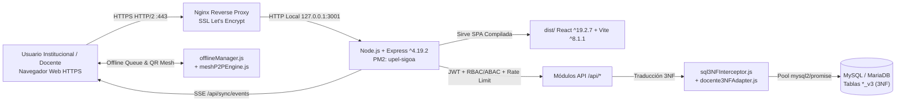
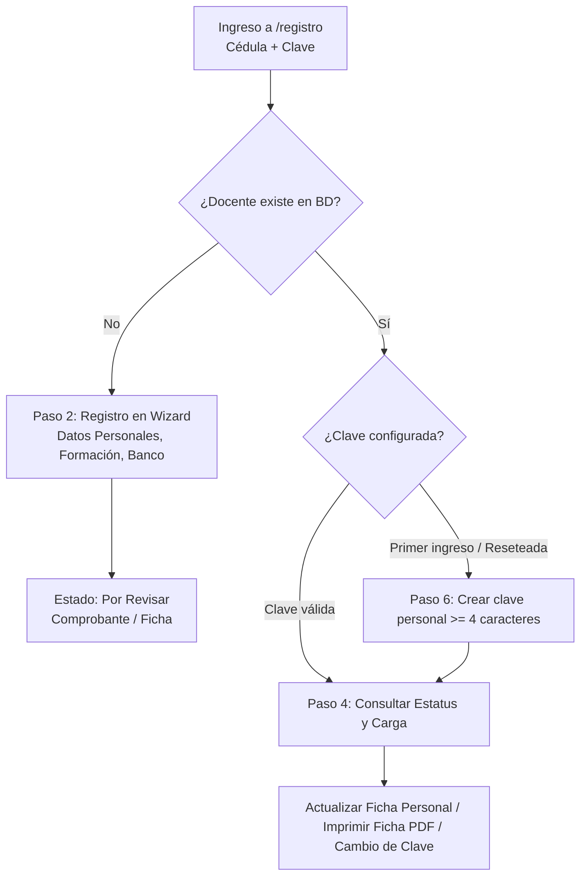
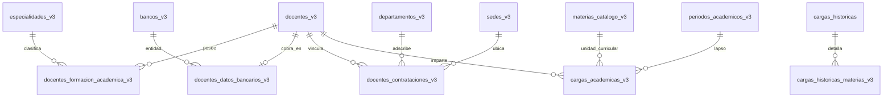
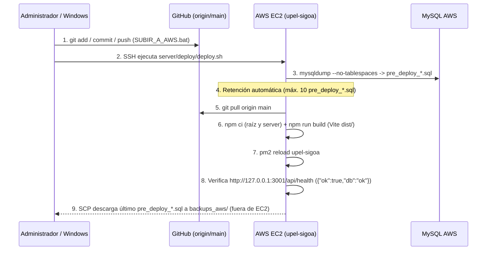

# Manual Institucional y de Operación Técnica — UPEL SIGOA

**Sistema Integrado de Gestión, Organización Académica y Talento Humano**  
**Institución:** Universidad Pedagógica Experimental Libertador (UPEL) — Instituto Pedagógico Rural *Gervasio Rubio* (IPRGR)  
**Cobertura Territorial:** Sede Principal **Rubio** · Extensión **Sabana de Mendoza** · Extensión **Encontrados**  
**Producción en Línea:** `https://3.133.148.107/`  
**Versión del Documento:** 2.0 (Nivel Senior — Operación Funcional, Seguridad, Arquitectura 3NF e Infraestructura Cloud)

---

## Tabla de Contenido

1. [Propósito, Alcance Institucional y Estructura Organizativa](#1-propósito-alcance-institucional-y-estructura-organizativa)
2. [Arquitectura General del Sistema y Stack Tecnológico](#2-arquitectura-general-del-sistema-y-stack-tecnológico)
3. [Modelo de Seguridad, Autenticación y Matriz de Roles (RBAC/ABAC)](#3-modelo-de-seguridad-autenticación-y-matriz-de-roles-rbacabac)
4. [Guía Operativa por Perfil Institucional](#4-guía-operativa-por-perfil-institucional)
   - [4.1 Portal de Autogestión Docente (`/registro`)](#41-portal-de-autogestión-docente-registro)
   - [4.2 Jefatura de Departamento (`/departamento/:deptName`)](#42-jefatura-de-departamento-departamentodeptname)
   - [4.3 Subdirección de Docencia y Programación Académica (`/docencia`)](#43-subdirección-de-docencia-y-programación-académica-docencia)
   - [4.4 Coordinación de Talento Humano — Administrador (`/`, `/usuarios`, `/consultar`)](#44-coordinación-de-talento-humano--administrador--usuarios-consultar)
   - [4.5 Contraloría y Auditoría (`/auditoria`)](#45-contraloría-y-auditoria-auditoria)
5. [Módulos Avanzados de Resiliencia y Gobierno de Datos](#5-módulos-avanzados-de-resiliencia-y-gobierno-de-datos)
   - [5.1 Bóveda de Respaldos, Integridad y Modo Mantenimiento (`/respaldos`)](#51-bóveda-de-respaldos-integridad-y-modo-mantenimiento-respaldos)
   - [5.2 Operación Offline y Sincronización Mesh P2P (`/mesh`)](#52-operación-offline-y-sincronización-mesh-p2p-mesh)
   - [5.3 Gestión de Períodos Académicos (`YYYY-I` / `YYYY-II`)](#53-gestión-de-períodos-académicos-yyyy-i--yyyy-ii)
6. [Arquitectura de Datos Relacional en Tercera Forma Normal (3NF)](#6-arquitectura-de-datos-relacional-en-tercera-forma-normal-3nf)
7. [Referencia Técnica de Rutas Web y Endpoints API (`/api`)](#7-referencia-técnica-de-rutas-web-y-endpoints-api-api)
8. [Infraestructura en la Nube (AWS EC2), Despliegue y Respaldo Externo](#8-infraestructura-en-la-nube-aws-ec2-despliegue-y-respaldo-externo)
9. [Manual de Operación Local y Mantenimiento (Windows)](#9-manual-de-operación-local-y-mantenimiento-windows)
10. [Aseguramiento de Calidad (QA), Pruebas y Resolución de Incidentes](#10-aseguramiento-de-calidad-qa-pruebas-y-resolución-de-incidentes)

---

## 1. Propósito, Alcance Institucional y Estructura Organizativa

**UPEL SIGOA** es la plataforma institucional encargada de auditar, normalizar, planificar y respaldar el registro de personal docente, su formación académica, datos bancarios, contrataciones, carga académica por lapso y programación de unidades curriculares en el Instituto Pedagógico Rural *Gervasio Rubio* y sus extensiones.

### 1.1 Sedes Institucionales

| Sede / Extensión | Identificador en Plataforma | Encabezado Institucional Aplicado |
| :--- | :--- | :--- |
| **Sede Principal** | `Rubio` | Instituto Pedagógico Rural Gervasio Rubio - Sede Principal |
| **Extensión Trujillo** | `Sabana de Mendoza` | Instituto Pedagógico Rural Gervasio Rubio - Extensión Sabana de Mendoza |
| **Extensión Zulia** | `Encontrados` | Instituto Pedagógico Rural Gervasio Rubio - Extensión Encontrados |

### 1.2 Departamentos Académicos y Especialidades Activas

El sistema separa estrictamente la adscripción administrativa (**Departamentos**) de la formación/titulación curricular (**Especialidades**):

- **Departamentos Académicos (`departments`):**
  1. `Matemática`
  2. `Pedagogía`
  3. `Ciencias Sociales`
  4. `Agroindustrial`

- **Especialidades Curriculares (`especialidades`, 14 vigentes):**
  - `Artes Escénicas`
  - `Educación Agropecuaria`
  - `Educación Especial para Personas en Situación de Discapacidad`
  - `Educación Física`
  - `Educación Informática`
  - `Educación Inglés`
  - `Educación Inicial`
  - `Educación Musical`
  - `Educación Primaria`
  - `Educación Rural`
  - `Educación Socioproductiva`
  - `Geografía e Historia`
  - `Lengua y Literatura`
  - `Matemática`

---

## 2. Arquitectura General del Sistema y Stack Tecnológico

SIGOA opera bajo una arquitectura cliente-servidor desacoplada con renderizado SPA en el navegador, proxy inverso HTTPS en Nginx, servidor de aplicaciones Node.js/Express, persistencia relacional en MySQL/MariaDB (3NF) y cola local offline con sincronización en tiempo real vía Server-Sent Events (SSE).



### Inventario Tecnológico Verificado

| Capa | Tecnología / Módulo | Responsabilidad |
| :--- | :--- | :--- |
| **Frontend SPA** | React `^19.2.7`, Vite `^8.1.1`, `react-router-dom` | Vistas con carga perezosa resiliente (`lazyWithRetry`), exportación Excel/PDF bajo demanda |
| **Backend API** | Node.js, Express `^4.19.2` (`server/index.js`) | Enrutamiento REST bajo `/api`, servidor estático `dist/`, fallback SPA, SSE y cron de cierre de lapsos |
| **Base de Datos** | `mysql2 ^3.10.0` (`server/db.js`) | Pool de `75` conexiones en modo estándar (o proporcional en cluster), `group_concat_max_len = 4194304`, keep-alive cada 10 min |
| **Capa 3NF** | `server/utils/sql3NFInterceptor.js`, `docente3NFAdapter.js` | Desacople relacional transparente hacia tablas normalizadas `*_v3` |
| **Seguridad** | JWT (`Authorization: Bearer` / `?token=`), `bcrypt` | Autenticación sin estado, hash seguro y bloqueo progresivo por fuerza bruta |
| **Resiliencia Offline** | `src/services/offlineManager.js`, `meshP2PEngine.js` | Cola de mutaciones local, caché optimista e intercambio P2P por códigos QR |
| **Infraestructura** | AWS EC2 Ubuntu, Nginx, PM2 + `pm2-logrotate` | Terminación TLS/HTTP2, supervisión automática y respaldos pre-despliegue |

---

## 3. Modelo de Seguridad, Autenticación y Matriz de Roles (RBAC/ABAC)

### 3.1 Autenticación y Protección de Credenciales

- **Cifrado de contraseñas (`bcrypt`):** Todas las claves de usuarios administrativos y de docentes del portal se almacenan con hash `bcrypt` (`server/utils/security.js`). Al iniciar el servidor, `dbInit.service.js` ejecuta `migrateLegacyPlaintextPasswords()` para migrar automáticamente cualquier credencial heredada en texto plano.
- **Tokens JWT (`server/middlewares/auth.js`):** El servidor emite tokens firmados que el cliente envía en la cabecera `Authorization: Bearer <token>` (o mediante parámetro `?token=` para descargas/SSE autenticadas).
- **Control de fuerza bruta (`server/routes/auth.routes.js`):** `POST /api/login` limita a **`5` intentos fallidos** por dirección IP antes de aplicar un bloqueo temporal de **`5 minutos`** (`LOCKOUT_TIME_MS = 5 * 60 * 1000`). Las peticiones de diagnóstico desde `localhost` quedan exentas.
- **Limitadores adicionales:** Los endpoints sensibles del portal (`/api/docentes/recuperar-clave` y `/api/docentes/cambiar-clave-portal`) aplican `createRateLimiter` dedicado.

### 3.2 Niveles de Autorización (`requireAuth`, `requireStaffAuth`, `requireRole`, ABAC)

1. **`requireAuth`:** Exige JWT válido (`401` si falta o expiró). Permite el acceso al propio docente autenticado en el portal (`DOCENTE_PORTAL`).
2. **`requireStaffAuth`:** Exige pertenecer a `STAFF_ROLES = ['ADMIN', 'AUDITOR', 'DOCENCIA', 'JEFE']` (`403` para `DOCENTE_PORTAL`).
3. **`requireRole(...)`:** Restringe operaciones críticas como gestión de usuarios o Bóveda de Respaldos exclusivamente al rol requerido (por ejemplo, `ADMIN`).
4. **ABAC (Control Basado en Atributos):**
   - Un **`DOCENTE_PORTAL`** solo puede leer o modificar la ficha vinculada a su propia cédula (`canAccessDocenteRecord`), nunca la de terceros.
   - Un **`JEFE`** queda restringido estrictamente a su departamento académico; si intenta navegar a rutas exclusivas de administración, `ProtectedRoute` (`src/App.jsx`) lo redirige a `/departamento/<su_departamento>`.

### 3.3 Matriz de Permisos por Rol

| Capacidad / Ruta | `DOCENTE_PORTAL` | `JEFE` | `DOCENCIA` | `AUDITOR` | `ADMIN` |
| :--- | :---: | :---: | :---: | :---: | :---: |
| Portal de Autogestión (`/registro`) | Propia cédula | Público | Público | Público | Público |
| Dashboard Ejecutivo (`/`) | — | Redirige | Redirige | Lectura | Completo |
| Gestión Departamental (`/departamento/:deptName`) | — | Solo su depto. | Consulta/Gestión | Consulta | Completo |
| Consulta Global de Docentes (`/consultar`) | — | Permitido | Permitido | Permitido | Permitido |
| Programación Académica (`/docencia`) | — | Permitido | Permitido | Permitido | Permitido |
| Red Mesh P2P y Sync (`/mesh`) | — | Permitido | Permitido | Permitido | Permitido |
| Bitácora de Auditoría (`/auditoria`) | — | — | — | Lectura | Completo + Purga |
| Gestión de Usuarios (`/usuarios`) | — | — | — | — | Completo |
| Bóveda de Respaldos y Mantenimiento (`/respaldos`) | — | — | — | — | Completo |

---

## 4. Guía Operativa por Perfil Institucional

### 4.1 Portal de Autogestión Docente (`/registro`)

Ruta pública (`PortalDocenteRoute`) diseñada para que el personal docente registre y actualice su expediente sin requerir cuenta administrativa, sujeto al estado de habilitación del registro y al Modo Mantenimiento Estricto.



**Flujo operativo paso a paso:**
1. **Validación de identidad (`/api/docentes/validar-portal`):** El docente ingresa su número de cédula y clave personal.
2. **Primer ingreso o recuperación (`/api/docentes/recuperar-clave`):**
   - Si olvidó su clave, selecciona *"¿Olvidaste tu clave?"*, introduce su **cédula** y su **correo personal o institucional registrado**. Al validar coincidencia, el sistema restablece su acceso temporalmente a los **últimos 4 dígitos de la cédula** (`clave = NULL`) y obliga a definir una nueva clave en el siguiente ingreso (`/api/docentes/cambiar-clave-portal`, mínimo 4 caracteres).
3. **Llenado o actualización de ficha (`/api/docentes/portal-actualizar-ficha`):** El asistente (`RegistrationWizard`) recopila identificación, contactos, departamento/especialidad, formación académica y datos bancarios.
4. **Restricción institucional:** El docente **no puede alterar su propia carga académica ni sus horas**; cualquier ajuste de unidades curriculares corresponde al Jefe de Departamento o Subdirección de Docencia.
5. **Impresión oficial:** Desde el Paso 4/5 (`PrintableFicha`), el docente visualiza su estatus (`Por Revisar` o `Validado`) e imprime o descarga su ficha formal.

---

### 4.2 Jefatura de Departamento (`/departamento/:deptName`)

El **Jefe de Departamento** concentra la validación de expedientes y la distribución semestral de carga docente en su departamento asignado (`Matemática`, `Pedagogía`, `Ciencias Sociales` o `Agroindustrial`).

**Procedimiento estándar:**
1. Iniciar sesión en `/login` con usuario y contraseña asignados.
2. El sistema carga automáticamente `/departamento/<nombre_departamento>` e impide visualizar o editar docentes de otros departamentos.
3. Revisar los indicadores de estatus (`Por revisar`, `Validado`) y localizar al docente.
4. Abrir el expediente para:
   - Verificar datos personales, título académico y estatus administrativo.
   - Ir a la sección **Carga Académica**, seleccionar la unidad curricular desde el catálogo institucional (`materias_catalogo`) e indicar **horas semanales / horas lapso** y **sede**.
   - Añadir filas si el docente dicta múltiples unidades curriculares y pulsar **Guardar Carga** (`PUT /api/docentes/carga`).
5. Emitir la ficha individual imprimible o consultar el histórico de cargas (`GET /api/docentes/:cedula/historico`).

---

### 4.3 Subdirección de Docencia y Programación Académica (`/docencia`)

El módulo `ProgramacionAcademica.jsx` centraliza la planificación académica del instituto y el control curricular por sede y período. Consta de **tres pestañas principales**:

1. **Oferta Académica:** Filtrado por período académico, sede (`Rubio`, `Sabana de Mendoza`, `Encontrados`), especialidad y término de búsqueda; exportación y vista previa en Excel (`ExcelPreviewModal`).
2. **Materias Huérfanas (`GET /api/periodos/:nombre/huerfanas`):** Cruza el catálogo maestro (`materias_catalogo`) contra las asignaciones vigentes del período seleccionado (tabla activa `docentes_materias` o `cargas_historicas` en lapsos cerrados) para identificar exactamente qué unidades curriculares aún **no tienen docente asignado**.
3. **Cuadro Consolidado de Necesidades (`GET /api/periodos/:nombre/necesidades`):** Genera el reporte analítico para Consejo Académico con la cobertura docente real del lapso.

---

### 4.4 Coordinación de Talento Humano — Administrador (`/`, `/usuarios`, `/consultar`)

El rol **`ADMIN`** ejerce el gobierno integral de la plataforma:

- **Dashboard Ejecutivo (`/`):** Indicadores globales de nómina docente, distribución por departamento/sede, alertas de expedientes incompletos y accesos rápidos (paleta de comandos en `Layout.jsx`).
- **Consulta Global (`/consultar`):** Búsqueda transversal en todos los departamentos y especialidades, edición integral de fichas (`POST /api/docentes`), baja administrativa (`DELETE /api/docentes/:cedula`), envío de ficha por correo (`POST /api/send-ficha-email`) y escaneo asistido por IA (`POST /api/ai/scan-document`) cuando esté configurada la clave Gemini.
- **Gestión de Usuarios (`/usuarios`):** Creación, edición y revocación de cuentas administrativas (`GET/POST/PUT/DELETE /api/users`) y autorizaciones (`/api/autorizaciones`), además de personalización institucional (fondo de login en `/api/config/login-bg`, flyer institucional en `/api/config/flyer` y configuración SMTP en `/api/mail-config`).
- **Catálogo de Materias:** Alta y actualización de unidades curriculares globales (`GET/POST /api/materias-catalogo`).

---

### 4.5 Contraloría y Auditoría (`/auditoria`)

Todas las acciones sensibles (cambios de clave, altas/bajas de docentes, ajustes de carga, replicación o reapertura de períodos, restauraciones y purgas) quedan registradas en bitácora (`auditService.js`).

- **`AUDITOR` y `ADMIN`** consultan la bitácora en `/auditoria` (`GET /api/audit`) con trazabilidad de actor, rol, acción, detalle e IP.
- Solo **`ADMIN`** puede ejecutar depuración/purga histórica controlada (`POST /api/audit/purge`).

---

## 5. Módulos Avanzados de Resiliencia y Gobierno de Datos

### 5.1 Bóveda de Respaldos, Integridad y Modo Mantenimiento (`/respaldos`)

Accesible exclusivamente para **`ADMIN`** (`BackupVault.jsx` + `backup.routes.js`), ofrece cinco dimensiones operativas:

| Pestaña | Endpoints Asociados | Función Operativa |
| :--- | :--- | :--- |
| **Respaldos y Restauración** | `GET /api/backup/stats`, `/sql`, `/json`, `POST /api/backup/restore` | Descarga inmediata de volcado completo `.sql` (streaming) o `.json`, estadísticas de tablas y restauración controlada desde archivo de respaldo |
| **Optimización y Mantenimiento** | `GET /api/backup/maintenance/status`, `POST /api/backup/maintenance` | Limpieza y compactación histórica de logs superando `diasRetencion` (valor predeterminado: **`180` días**) |
| **Integridad Relacional** | `GET /api/backup/integrity`, `POST /api/backup/integrity/repair` | Diagnóstico de registros huérfanos o inconsistencias en llaves y reparación automática segura |
| **Salud del Servidor** | `/api/health`, `/api/backup/stats` | Monitoreo en tiempo real del estado del proceso Node y latencia de base de datos (`SELECT 1`) |
| **Modo Mantenimiento Estricto** | `GET/POST /api/backup/maintenance-mode` | Persiste `server/maintenance_config.json`; cuando `enabled && strictLockout`, bloquea `/registro` y toda sesión no-`ADMIN` con `MaintenanceLockscreen` |

---

### 5.2 Operación Offline y Sincronización Mesh P2P (`/mesh`)

SIGOA está preparado para contingencias de conectividad en sedes rurales mediante dos mecanismos coordinados:

1. **Cola Offline (`src/services/offlineManager.js`):** Al perder enlace con el servidor central, las lecturas recientes se sirven desde caché local y las mutaciones se encolan de forma optimista en el navegador. Al restablecerse la conexión, se sincronizan en lote mediante `POST /api/sync/batch`.
2. **Red Mesh P2P por QR (`src/services/meshP2PEngine.js`):** Desde `/mesh` (`MeshP2PControl.jsx`), el personal autorizado (`ADMIN`, `DOCENCIA`, `JEFE`, `AUDITOR`) dispone de cuatro vistas (`radar`, `qr`, `contingencia`, `log`) para **exportar mutaciones pendientes en formato QR**, escanear/fusionar paquetes provenientes de otro equipo local en contingencia y realizar el **uplink consolidado** hacia el servidor central cuando exista acceso a Internet.

---

### 5.3 Gestión de Períodos Académicos (`YYYY-I` / `YYYY-II`)

La plataforma implementa el régimen semestral UPEL (`periodos.routes.js`):

- **Período Activo único (`POST /api/periodos/activar`):** La carga vigente reside en las tablas activas del esquema 3NF.
- **Replicación entre lapsos (`POST /api/periodos/replicar`):** Permite proyectar la estructura docente y materias al lapso siguiente (`YYYY-I` ↔ `YYYY-II`) sin recapturar expedientes.
- **Cierre y Reactivación:**
  - `PUT /api/periodos/:id/cerrar`: Consolida las asignaciones en `cargas_historicas` y `cargas_historicas_materias_v3` para preservar trazabilidad histórica inalterable.
  - `PUT /api/periodos/:id/reactivar`: Requiere identificación de auditor y motivo explícito para reabrir un período cerrado.
  - **Cierre Automático Programado:** `server/index.js` ejecuta cada hora la rutina `verificarCierreAutomaticoLapsos()` para cerrar lapsos vencidos según fecha programada.

---

## 6. Arquitectura de Datos Relacional en Tercera Forma Normal (3NF)

Para garantizar compatibilidad con consultas heredadas y al mismo tiempo mantener integridad referencial sin redundancia, SIGOA utiliza un patrón de **adaptación relacional transparente**:



### Componentes Clave de la Capa de Datos

- **`server/db.js`:** Administra el pool de conexiones `mysql2/promise` (`connectionLimit = 75` en instancia única o `Math.max(15, Math.floor(200 / numCpus))` en cluster), fuerza `SET SESSION group_concat_max_len = 4194304` por conexión y ejecuta pings keep-alive cada 10 minutos. Exposición directa sin interceptor mediante `db.nativeQuery(...)` cuando es requerido (por ejemplo, en el health check).
- **`server/utils/sql3NFInterceptor.js` y `docente3NFAdapter.js`:** Interceptan operaciones dirigidas a entidades lógicas (`docentes`, `docentes_materias`, `cargas_historicas`, `periodos_academicos`, `materias_catalogo`, `usuarios`, `autorizaciones`) y las traducen a las tablas físicas normalizadas (`*_v3`), evitando duplicación de nombres de bancos, especialidades, sedes, departamentos o unidades curriculares.
- **`server/services/docentesCache.service.js`:** Mantiene caché en memoria con invalidación selectiva ante escrituras, sincronizada con la caché RAM de 15 segundos en frontend (`src/data.js`).

---

## 7. Referencia Técnica de Rutas Web y Endpoints API (`/api`)

### 7.1 Rutas de Aplicación Frontend (`src/App.jsx`)

| Ruta Web | Componente (`src/components/`) | Acceso Permitido |
| :--- | :--- | :--- |
| `/registro` | `PublicRegistration.jsx` | Público / Docente (bloqueable por Mantenimiento Estricto) |
| `/login` | `Login.jsx` | Público (personal institucional) |
| `/` | `Dashboard.jsx` | `ADMIN`, `AUDITOR` |
| `/consultar` | `ConsultarDocentes.jsx` | `ADMIN`, `AUDITOR`, `JEFE`, `DOCENCIA` |
| `/departamento/:deptName` | `StaffList.jsx` | Staff autenticado (`JEFE` limitado a su departamento) |
| `/docencia` | `ProgramacionAcademica.jsx` | `ADMIN`, `DOCENCIA`, `JEFE`, `AUDITOR` |
| `/mesh` | `MeshP2PControl.jsx` | `ADMIN`, `DOCENCIA`, `JEFE`, `AUDITOR` |
| `/auditoria` | `AuditLogs.jsx` | `ADMIN`, `AUDITOR` |
| `/usuarios` | `UserManagement.jsx` | `ADMIN` |
| `/respaldos` | `BackupVault.jsx` | `ADMIN` |

### 7.2 Catálogo de Endpoints Backend (`server/routes/*.js`)

| Módulo | Endpoints Principales | Propósito |
| :--- | :--- | :--- |
| **Sistema (`index.js`)** | `GET /api/health` | Health check activo: ejecuta `SELECT 1` con timeout de `2000ms` (`{"ok":true,"db":"ok"}`) |
| **Auth (`auth.routes.js`)** | `POST /api/login` | Autenticación JWT con límite de 5 intentos y bloqueo de 5 min por IP |
| **Docentes (`docentes.routes.js`)** | `GET/POST /api/docentes`, `DELETE /api/docentes/:cedula`, `PUT /api/docentes/carga`, `GET /api/docentes/:cedula/historico`, `POST /api/docentes/validar-portal`, `/recuperar-clave`, `/cambiar-clave-portal`, `/portal-actualizar-ficha` | Gestión integral de expedientes, cargas y autoservicio seguro del portal |
| **Períodos (`periodos.routes.js`)** | `GET/POST /api/periodos`, `PUT /api/periodos/:id`, `POST /api/periodos/activar`, `/replicar`, `PUT /api/periodos/:id/cerrar`, `/reactivar`, `GET /api/periodos/:nombre/huerfanas`, `/necesidades`, `GET /api/historico-periodos` | Ciclo de vida semestral, detección de materias sin asignar y cuadro de necesidades |
| **Materias (`materias.routes.js`)** | `GET/POST /api/materias-catalogo` | Catálogo oficial de unidades curriculares |
| **Usuarios (`usuarios.routes.js`)** | `GET/POST/PUT/DELETE /api/users`, `GET/POST/DELETE /api/autorizaciones` | Administración de cuentas de personal y autorizaciones |
| **Auditoría (`auditoria.routes.js`)** | `GET /api/audit`, `POST /api/audit/purge`, `GET /api/backup` | Consulta de trazabilidad y purga administrativa |
| **Respaldo (`backup.routes.js`)** | `GET /api/backup/stats`, `/sql`, `/json`, `POST /api/backup/restore`, `GET/POST /api/backup/maintenance`, `/maintenance/status`, `/integrity`, `/integrity/repair`, `/maintenance-mode` | Bóveda de respaldos, integridad referencial, limpieza histórica y modo mantenimiento |
| **Sincronización (`sync.routes.js`)** | `GET /api/sync/events`, `/version`, `POST /api/sync/notify`, `/batch`, `/migrate`, `GET /api/external-data`, `POST /api/sync-external` | SSE en tiempo real, sincronización batch offline y pasarela externa |
| **Configuración (`config.routes.js`)** | `GET/POST /api/config/login-bg`, `/login-bg/reset`, `/flyer`, `/flyer/reset` | Identidad visual del login y comunicados/flyer institucional |
| **Correo (`mail.routes.js`)** | `GET/POST /api/mail-config`, `POST /api/test-mail`, `/send-ficha-email` | Configuración SMTP y envío de fichas por correo |
| **IA (`ai.routes.js`)** | `POST /api/ai/configure-key`, `/scan-document` | Integración opcional con Gemini (`geminiService.js`) para lectura documental |

---

## 8. Infraestructura en la Nube (AWS EC2), Despliegue y Respaldo Externo

La instancia productiva opera en **AWS EC2 (Ubuntu)** bajo la IP pública `3.133.148.107` (`https://3.133.148.107/`), siguiendo el principio de **mínima exposición de puertos**: Node.js escucha únicamente en loopback (`HOST=127.0.0.1`, puerto `3001`) y todo el tráfico externo entra cifrado vía **Nginx**.

### 8.1 Componentes Productivos en el Servidor

- **Proxy Inverso y TLS (`server/deploy/nginx-sigoa.conf`):** Nginx sirve terminación HTTPS + HTTP/2 y redirige las peticiones a `http://127.0.0.1:3001`.
- **Renovación Automática de Certificado SSL:** Configurada mediante Let's Encrypt para IP (`enable-https-ip-aws.sh`) con tarea programada en `/etc/cron.d/certbot-sigoa-ip` (renovación automática periódica y recarga silenciosa de Nginx). Cuando se asigne un dominio institucional propio, utilizar `server/deploy/enable-https-aws.sh`.
- **Supervisión de Proceso y Rotación de Logs:** Proceso `upel-sigoa` administrado por **PM2**, respaldado por **`pm2-logrotate` (`3.0.1`)** configurado con rotación cada **`10M`**, retención de **`7`** archivos y compresión activa (`compress: true`) para proteger el disco raíz de la EC2.

### 8.2 Flujo de Despliegue Continuo Seguro (`SUBIR_A_AWS.bat` + `deploy.sh`)



- **Despliegue en un clic (`SUBIR_A_AWS.bat`):** Sube los cambios a GitHub, invoca `server/deploy/deploy.sh` en la EC2 y descarga automáticamente por SCP el respaldo `pre_deploy_*.sql` recién generado hacia la carpeta local `backups_aws/` (excluida en `.gitignore`).
- **Descarga manual de respaldo externo (`DESCARGAR_RESPALDO_AWS.bat`):** Permite obtener en cualquier momento desde Windows el respaldo SQL más reciente almacenado en AWS EC2 (`/var/www/backups/`), generando además una copia fuera del servidor en la nube.

---

## 9. Manual de Operación Local y Mantenimiento (Windows)

Para operación en servidor local de oficina o ambiente de desarrollo dentro del repositorio `SIGOA`:

| Script / Comando | Uso Recomendado | Comportamiento |
| :--- | :--- | :--- |
| **`INICIAR_TALENTO_HUMANO.bat`** | Uso institucional diario local | Abre dos terminales: backend Node (`cd server && node index.js`) e interfaz web Vite (`npm run dev -- --open`) |
| **`INICIAR_MODO_DESARROLLO.bat`** | Programación y pruebas locales | Igual arranque con hot-reload para edición de código fuente |
| **`EJECUTAR_RESPALDO_Y_MANTENIMIENTO.bat`** | Cierre semanal / preventivo local | Ejecuta `node server/scripts/backup_automatizado.js` para respaldo y optimización de base de datos |
| **`SUBIR_A_AWS.bat`** | Publicar actualización en la nube | `git push` + `deploy.sh` en EC2 + descarga SCP de respaldo a `backups_aws/` |
| **`DESCARGAR_RESPALDO_AWS.bat`** | Copia externa bajo demanda | Descarga por SCP el último snapshot `pre_deploy_*.sql` de la EC2 a `backups_aws/` |

> [!CAUTION]
> En operación local con `INICIAR_TALENTO_HUMANO.bat`, **no cierre las ventanas de consola abiertas** mientras el sistema esté en uso, ya que detendrían el backend Node y el servidor Vite. En AWS EC2 el sistema permanece activo 24/7 sin depender de ninguna PC local.

---

## 10. Aseguramiento de Calidad (QA), Pruebas y Resolución de Incidentes

### 10.1 Controles Automatizados antes de Desplegar

Antes de ejecutar `SUBIR_A_AWS.bat`, se recomienda validar la batería completa de calidad desde la raíz del proyecto:

```powershell
# 1. Análisis estático de código (React + Node.js, 0 warnings/errors esperados)
npm.cmd run lint

# 2. Compilación de producción (genera dist/ con code splitting)
npm.cmd run build

# 3. Suite de pruebas Backend (unitarias 3NF + integración real Express & MySQL)
npm.cmd test

# 4. Suite End-to-End Frontend (flujos críticos en navegador)
npm.cmd run test:e2e
```

### 10.2 Guía Rápida de Resolución de Incidentes (Troubleshooting)

| Síntoma | Causa Probable | Acción Correctiva |
| :--- | :--- | :--- |
| **`/api/health` responde error `503` o `db: "error"`** | Servicio MySQL/MariaDB detenido o pool saturado | En local: iniciar MySQL en XAMPP (`mysqld.exe`). En AWS: `sudo systemctl status mysql` y revisar logs con `pm2 logs upel-sigoa` |
| **Usuario bloqueado tras intentos en `/login`** | Rate limiter activado (`5` intentos fallidos) | Esperar **`5 minutos`** para desbloqueo automático por IP o verificar credenciales con `ADMIN` |
| **Docente no recuerda clave en `/registro`** | Credencial olvidada o ficha nueva | Usar *"¿Olvidaste tu clave?"* con su cédula y correo registrado (`/api/docentes/recuperar-clave`) para restablecer a los últimos 4 dígitos |
| **El sitio muestra pantalla institucional de mantenimiento** | `strictLockout` activado en `maintenance_config.json` | Ingresar como `ADMIN` a `/respaldos` -> pestaña **Modo Mantenimiento** y desactivar el bloqueo al concluir labores |
| **Advertencia de navegador por certificado IP o expiración SSL** | Renovación pendiente o acceso sin HTTPS | Verificar `https://3.133.148.107/` y en EC2 comprobar `/etc/cron.d/certbot-sigoa-ip` y `sudo nginx -t` |
| **Falla carga de módulo tras actualización reciente** | Caché de chunks de una compilación previa | El wrapper `lazyWithRetry` recarga automáticamente; si persiste, forzar recarga dura (`Ctrl + F5`) |

---

**Unidad de Informática · Subdirección de Docencia · Coordinación de Talento Humano**  
*Universidad Pedagógica Experimental Libertador — Instituto Pedagógico Rural Gervasio Rubio*
