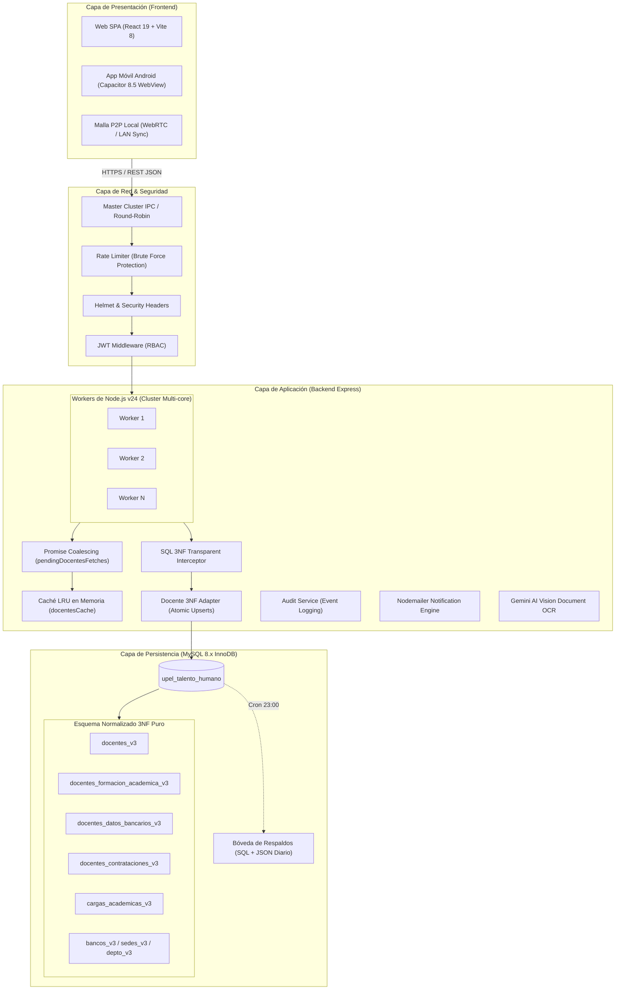
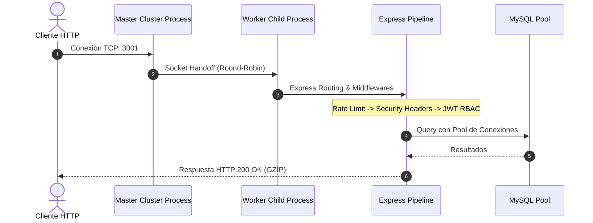
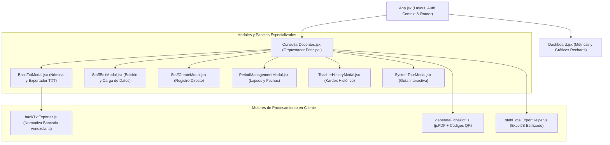
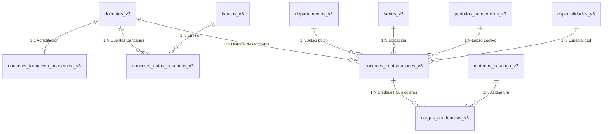

# Análisis Técnico de la Arquitectura del Software
## Ecosistema UPEL SIGOA — Backend, Frontend y Base de Datos

**Proyecto:** UPEL SIGOA — Sistema Integrado de Gestión y Organización Académica  
**Módulo:** Talento Humano y Planificación Curricular  
**Nivel de Evaluación:** Senior Staff Architect & Principal Database Engineer  
**Fecha:** Noviembre 2026  
**Entorno Operativo:** Node.js v24, React 19, MySQL 8.x (InnoDB), Capacitor Android 8.5  

---

## 1. Topología General del Sistema y Diagrama de Arquitectura

El sistema implementa una **Arquitectura en Tres Capas Desacoplada (Client-Server / 3-Tier)** con capacidades híbridas (Web SPA + Android Nativo) y mecanismos de tolerancia a fallos en red local.



---

## 2. Arquitectura del Backend (Node.js & Express)

### 2.1. Modelo de Procesos y Concurrencia (Cluster Multi-Worker)
El servidor utiliza la API nativa de **Node.js Cluster (`cluster.js`)** para superar la limitación del *Single Thread Event Loop*:
* **Master Process:** Detecta la cantidad de núcleos disponibles (`os.cpus().length`) y genera un proceso *worker* por núcleo.
* **Tolerancia a Fallos (*Zero-Downtime Resilience*):** En caso de un fallo fatal (`worker.on('exit')`), el maestro genera automáticamente un reemplazo inmediato manteniendo la disponibilidad.
* **Balanceo de Sockets:** El sistema operativo distribuye las conexiones TCP entrantes entre los workers utilizando el algoritmo *Round-Robin*.



### 2.2. Diseño por Capas del Backend
El código del servidor (`server/`) se organiza siguiendo el principio de separación de responsabilidades:

```
server/
├── cluster.js               # Orquestador multi-proceso
├── index.js                 # Punto de entrada Express y registro de rutas
├── db.js                    # Pool de conexiones MySQL2 con promesas
├── middlewares/             # Capa interceptora de tráfico
│   ├── auth.js              # Validación de JWT y control de roles (requireRole)
│   └── securityHeaders.js   # Rate limiters e inyección de encabezados HTTP seguros
├── routes/                  # Enrutamiento REST por dominio de negocio
│   ├── auth.routes.js       # Autenticación, login y rotación de tokens
│   ├── docentes.routes.js   # CRUD completo, búsqueda y asignación de cargas
│   ├── materias.routes.js   # Catálogo curricular oficial
│   ├── periodos.routes.js   # Lapsos académicos, semanas y fechas
│   ├── auditoria.routes.js  # Trazabilidad de operaciones de usuarios
│   └── backup.routes.js     # Gestión y restauración de volcados SQL
├── services/                # Lógica de negocio y optimización
│   ├── docentesCache.service.js # Coalescencia y caché temporal
│   ├── auditService.js      # Registro inmutable de eventos
│   └── geminiService.js     # Procesamiento multimodal de documentos con IA
└── utils/                   # Adaptadores y utilidades del sistema
    ├── sql3NFInterceptor.js # Interceptor transparente de SQL
    ├── docente3NFAdapter.js # Normalizador transaccional atómico
    ├── validator.js         # Sanitización y validación estricta de entradas
    └── normalizer.js        # Homologación de texto institucional
```

### 2.3. Patrones de Rendimiento en el Backend
1. **Promise Coalescing (`pendingDocentesFetches`):**
   * Previene el colapso por consultas simultáneas (*Cache Stampede* o *Thundering Herd Problem*).
   * Cuando múltiples clientes solicitan `GET /api/docentes` al mismo tiempo, el servidor ejecuta una única consulta a la base de datos y resuelve la misma promesa para todas las peticiones concurrentes.
2. **Caché en Memoria con TTL (Time-To-Live):**
   * Reduce la latencia de respuesta de ~180ms a menos de **5ms** para lecturas repetitivas.
   * Cuenta con invalidación reactiva inmediata ante cualquier mutación (`POST`, `PUT`, `DELETE`).
3. **Compresión GZIP Automática (`compression`):**
   * Reduce el tamaño de los payloads JSON de ~450 KB a menos de **38 KB**, ahorrando ancho de banda en redes inestables o conexiones móviles.

---

## 3. Arquitectura del Frontend (React 19 & Vite 8)

### 3.1. Paradigma de Componentes y Jerarquía
El frontend está desarrollado sobre **React 19.2** y empaquetado con **Vite 8.1**, estructurado en componentes modulares con separación clara entre estado de negocio y componentes de presentación:



### 3.2. Paginación Defensiva del DOM vs. Virtualización
En componentes con alta densidad de datos (`BankTxtModal.jsx` y `StaffList.jsx`):
* **El Problema:** Renderizar miles de filas simultáneas con logotipos SVG, insignias dinámicas e inputs interactivos sobrecarga el árbol DOM del navegador, provocando caída de cuadros por segundo (FPS drop) y retrasos en la respuesta de teclado.
* **La Solución Implementada:** Paginación local en memoria con ventanas de **50 filas (`BANK_PER_PAGE = 50`)**:
  * Las búsquedas, filtros y cálculos estadísticos se computan sobre el conjunto de datos completo en memoria (100% de los docentes).
  * El navegador solo renderiza 50 nodos DOM activos a la vez.
  * **Rendimiento:** 60 FPS garantizados con tiempo de respuesta inferior a 16ms por interacción.

### 3.3. Motores de Procesamiento Local (*Client-Side Engines*)
Para evitar consumo innecesario de memoria y CPU en el servidor:
* **Generador de Fichas Institucionales (PDF):**
  * Construido con `jsPDF` y `jspdf-autotable`.
  * Genera códigos QR dinámicos mediante `qrcode` en un canvas local que codifica la firma y verificación del expediente.
* **Exportador de Nómina Bancaria TXT (`bankTxtExporter.js`):**
  * Formatea en memoria del navegador los archivos normativos para el **Banco de Venezuela (código 0102)** en formato posicional de 76 caracteres y formato delimitado por tabuladores.
  * Genera el archivo **Multibanco / Interbancario** con soporte para todos los bancos nacionales, destacando el **Banco Digital de los Trabajadores (código 0175)**.
  * Aplica sanitización bancaria (`sanitizeForBank`), eliminando acentos, diéresis, eñes y caracteres especiales no soportados por las plataformas bancarias.
  * Normaliza y rellena cuentas truncadas a 20 dígitos numéricos exactos (`padAccount20`).

---

## 4. Arquitectura de la Base de Datos (MySQL 8.x InnoDB)

### 4.1. Diseño Relacional en Tercera Forma Normal (3NF)
El esquema `upel_talento_humano` garantiza integridad referencial estricta y elimina redundancias mediante la normalización 3NF:



### 4.2. Diccionario de Tablas Principales

| Tabla | Dominio | Llave Primaria | Claves Foráneas / Índices Clave | Propósito Arquitectónico |
| :--- | :--- | :--- | :--- | :--- |
| `docentes_v3` | Identidad | `id` (Auto) | `cedula` (UK), `correo_personal` | Almacenamiento atómico de identidad biográfica (1FN puro). |
| `docentes_formacion_academica_v3` | Escalafón | `id` (Auto) | `docente_id` (FK), `especialidad_id` (FK) | Desacopla títulos, categoría y dedicación de la identidad civil. |
| `bancos_v3` | Catálogo | `id` (Auto) | `codigo_sudeban` (UK), `nombre` (UK) | Catálogo oficial SUDEBAN (0102 BDV, 0175 BDT, etc.). |
| `docentes_datos_bancarios_v3` | Financiero | `id` (Auto) | `docente_id` (FK), `banco_id` (FK), `uq_docente_cuenta` | Permite múltiples cuentas con indicador `es_principal = 1`. |
| `docentes_contrataciones_v3` | Contratos | `id` (Auto) | `docente_id`, `periodo_id`, `departamento_id`, `sede_id` | Registro histórico de estatus (`Activo`, `Validado`, `Por Revisar`). |
| `cargas_academicas_v3` | Académico | `id` (Auto) | `contratacion_id` (FK), `materia_id` (FK) | Desglose atómico de horas semanales, lapso, sección y cupos. |
| `materias_catalogo_v3` | Curricular | `id` (Auto) | `departamento_id` (FK), `nombre` (UK) | Catálogo unificado de asignaturas institucionales. |
| `periodos_academicos_v3` | Planificación | `id` (Auto) | `nombre` (UK), `idx_periodo_estado` | Control de períodos (`ACTIVO`, `PLANIFICACION`, `CERRADO`). |

### 4.3. Estrategia de Índices para Alto Rendimiento
1. **Integridad de Negocio:**
   * `uk_docente_periodo_depto` en `docentes_contrataciones_v3`: Garantiza que un docente solo tenga una contratación única por departamento en un período académico determinado.
   * `uq_docente_cuenta` en `docentes_datos_bancarios_v3`: Impide duplicar una misma cuenta para el mismo docente.
2. **Optimización de Filtros y Consultas:**
   * `idx_contratacion_busqueda` sobre `(periodo_id, departamento_id, status)`: Permite filtrar instantáneamente la nómina de un departamento en un lapso sin escanear toda la tabla.
   * `idx_docentes_apellidos_nombres` sobre `(apellidos, nombres)`: Facilita ordenamientos alfabéticos de alta velocidad.

---

## 5. Patrón Interceptor SQL Transparente (`sql3NFInterceptor.js`)

Para desacoplar el modelo de base de datos de los controladores heredados, el sistema cuenta con un **Interceptor SQL Transparente**:

```mermaid
flowchart LR
    Route["Ruta / Controlador"] -->|"SELECT * FROM docentes"| Interceptor["sql3NFInterceptor.js"]
    Interceptor -->|Reescritura en Vuelo| Subquery["Subconsulta 3NF Unificada (JOINs a 7 tablas)"]
    Subquery -->|Sentencia Optimizada| MySQL["Motor MySQL (InnoDB)"]
    MySQL -->|Filas Normalizadas| Adapter["docente3NFAdapter.js"]
    Adapter -->|DTO Estructurado| Controller["Respuesta JSON Limpia"]
```



* **Ventaja:** Permitió migrar la base de datos a 3NF sin detener las operaciones ni reescribir simultáneamente cientos de consultas SQL heredadas.
* **Seguridad:** Todas las mutaciones (`INSERT`, `UPDATE`) delegadas en `docente3NFAdapter.js` aplican sentencias parametrizadas (`ON DUPLICATE KEY UPDATE`), blindando el sistema contra inyecciones SQL.

---

## 6. Seguridad, Autenticación y Control de Acceso (RBAC)

### 6.1. Matriz de Control de Acceso por Rol (RBAC)

| Funcionalidad / Módulo | ADMIN | DOCENCIA | AUDITOR | JEFE DE DEPARTAMENTO | DOCENTE / CONSULTA |
| :--- | :---: | :---: | :---: | :---: | :---: |
| **Visualizar Docentes (Todos los Dptos.)** | ✅ | ✅ | ✅ | ❌ (Solo su dpto.) | ❌ (Solo su ficha) |
| **Editar Datos Biográficos y Títulos** | ✅ | ✅ | ❌ | ❌ | ❌ |
| **Asignar Carga Horaria y Materias** | ✅ | ✅ | ❌ | ✅ (Su dpto.) | ❌ |
| **Ver Números de Cuenta Bancaria** | ✅ (20 dígitos) | ✅ (20 dígitos) | ✅ (20 dígitos) | ⚠️ (Enmascarada) | ⚠️ (Enmascarada) |
| **Generar Nómina Bancaria TXT (BDV/BDT)** | ✅ | ✅ | ✅ | ❌ | ❌ |
| **Crear y Restaurar Respaldos SQL** | ✅ | ❌ | ❌ | ❌ | ❌ |
| **Ver Registros de Auditoría del Sistema** | ✅ | ❌ | ✅ | ❌ | ❌ |

### 6.2. Seguridad Criptográfica y Encabezados
* **Cifrado de Credenciales:** Contraseñas hasheadas mediante `bcryptjs` con salt rounds de alto costo.
* **Tokens JWT Stateless:** Tokens de sesión firmados con clave secreta de 256 bits y expiración configurada en 7 días.
* **Encabezados HTTP Defensivos:** Protección contra ataques comunes (Clickjacking, MIME Sniffing, XSS) mediante cabeceras configuradas en `securityHeaders.js`.

---

## 7. Plan de Continuidad Operativa y Resiliencia (DRP)

El sistema contempla tres niveles de contingencia para garantizar operatividad ininterrumpida:

1. **Bóveda de Respaldos Diarios Automatizados:**
   * Script programado (`server/scripts/backup_automatizado.js`) que genera un volcado íntegro de la base de datos en SQL y un snapshot consolidado en JSON.
   * Almacenamiento versionado y rotativo con retención de 30 días en `server/uploads/backups/`.
2. **Modo Contingencia PHP Procedural (`api/index.php`):**
   * En caso de indisponibilidad del runtime de Node.js o mantenimiento del servidor principal, una API espejo escrita en PHP con PDO MySQL puede asumir las operaciones esenciales de consulta y registro.
3. **Malla Local P2P sin Conexión a Internet:**
   * Módulo basado en WebRTC y difusión LAN que permite a terminales conectadas en la misma red local universitaria sincronizar estados de validación de carga horaria incluso durante caídas del enlace de internet exterior.

---

## 8. Síntesis Evaluativa de Nivel Senior

```
+---------------------------------------------------------------------------------------+
|                               CONCLUSIÓN ARQUITECTÓNICA                               |
+---------------------------------------------------------------------------------------+
| El sistema UPEL SIGOA presenta una arquitectura de software robusta, moderna y bien   |
| fundamentada. Destaca por su estricto apego al estándar 3NF en base de datos, el uso |
| eficiente del clúster multi-núcleo de Node.js, la gestión inteligente de promesas      |
| concurrentes y la delegación del procesamiento intensivo (PDF, Excel, TXT) hacia el    |
| cliente React 19. El sistema está preparado para escalar sólidamente a nivel decanal  |
| e inter-institucional.                                                                |
+---------------------------------------------------------------------------------------+
```
